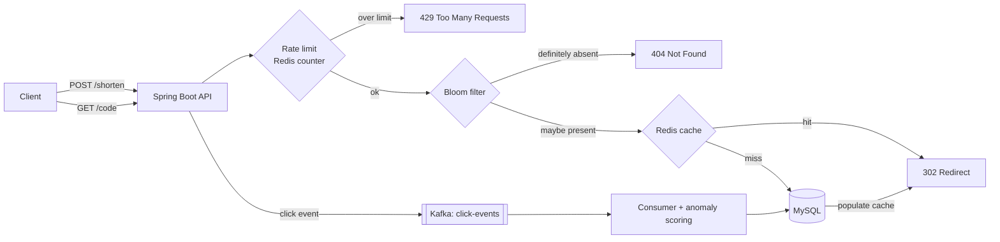

# URL Shortener

A scalable URL shortener built with **Spring Boot**. It generates short links with distributed-style unique IDs, serves redirects from a **Redis** cache guarded by a **Bloom filter**, and records click analytics asynchronously through **Kafka**.

---

## Features

- **Short link creation**: `POST /shorten` turns a long URL into a short code. Submitting the same URL again returns the existing link instead of creating a duplicate.
- **Fast redirects**: `GET /{shortCode}` redirects to the original URL. Lookups go Bloom filter, then Redis, then MySQL.
- **Snowflake IDs + Base62**: each link gets a 64-bit time-ordered ID, encoded in Base62 for a short, URL-safe code. No central counter and no random-collision retries.
- **Bloom filter**: an in-memory filter rejects codes that were never created, so invalid requests never reach Redis or the database. It is rebuilt from MySQL on startup.
- **Async click analytics**: every redirect publishes a click event to Kafka. A consumer stores it in MySQL, so tracking never slows down the redirect.
- **Analytics API**: `GET /analytics/{shortCode}` returns total clicks, clicks per day and top referrers.
- **Rate limiting**: 100 requests per minute per IP, tracked in Redis.
- **Bot / anomaly scoring**: each click is scored on user-agent and referrer signals, and suspicious traffic is logged.
- **Clean error handling**: consistent JSON errors for validation failures, unknown codes and unexpected exceptions.

---

## Architecture



**Create flow:** Snowflake ID, then Base62 code, saved to MySQL, then added to the Bloom filter. A unique constraint on the long URL handles concurrent duplicate requests by returning the existing record.

**Redirect flow:** rate-limit check, Bloom filter, Redis (7-day TTL), MySQL fallback, then a click event goes to Kafka and the client is redirected.

---

## Tech stack

| Area | Technology |
| --- | --- |
| Language / framework | Java, Spring Boot, Spring Web, Spring Data JPA |
| Database | MySQL |
| Cache and rate limiting | Redis |
| Messaging | Apache Kafka |
| Validation | Jakarta Bean Validation |
| Testing | JUnit 5 |

---

## Getting started

### Prerequisites

- Java 17 or newer
- Maven (or the project's wrapper)
- MySQL, Redis and Kafka running locally

Example setup for MySQL and Redis with Docker:

```bash
docker run -d --name mysql -p 3306:3306 \
  -e MYSQL_ROOT_PASSWORD=changeme -e MYSQL_DATABASE=urlshortener mysql:8

docker run -d --name redis -p 6379:6379 redis:7
```

Start a Kafka broker on `localhost:9092` using your preferred setup.

### Configure

Settings live in `src/main/resources/application.properties`. Database credentials have no defaults, so set them as environment variables:

```bash
export DB_USERNAME=root
export DB_PASSWORD=changeme
```

| Variable | Description | Default |
| --- | --- | --- |
| `DB_USERNAME` | MySQL username | none (required) |
| `DB_PASSWORD` | MySQL password | none (required) |
| `SPRING_DATASOURCE_URL` | JDBC URL | `jdbc:mysql://localhost:3306/urlshortener` |
| `SPRING_DATA_REDIS_HOST` | Redis host | `localhost` |
| `SPRING_KAFKA_BOOTSTRAP_SERVERS` | Kafka brokers | `localhost:9092` |

Other properties you may want to change:

| Property | Description | Default |
| --- | --- | --- |
| `app.base-url` | Prefix for returned short URLs | `http://localhost:8080/` |
| `app.machine-id` | Snowflake machine ID (0-1023). **Must be unique per running instance.** | `1` |
| `app.trust-proxy-headers` | Whether to trust `X-Forwarded-For` | `false` |

### Run

```bash
./mvnw spring-boot:run
```

The API starts on http://localhost:8080. The Kafka topic is `click-events`, and the consumer group is `analytics-group-v3`.

### Run the tests

```bash
./mvnw test
```

The suite covers the Base62 encoder, Bloom filter, Snowflake generator, rate limiter and URL shortener service (cache hit and miss, Bloom filter short-circuit, duplicate inserts).

---

## API

### Shorten a URL

```http
POST /shorten
Content-Type: application/json

{ "longUrl": "https://example.com/some/very/long/path" }
```

Response `200 OK`:

```json
{
  "shortUrl": "http://localhost:8080/AbC123",
  "shortCode": "AbC123"
}
```

An empty or invalid URL returns `400` with an error message.

### Redirect

```http
GET /{shortCode}
```

Redirects to the original URL. Returns `404` if the code does not exist.

### Analytics

```http
GET /analytics/{shortCode}
```

```json
{
  "totalClicks": 42,
  "dailyClicks": [
    { "date": "2026-10-10", "count": 17 },
    { "date": "2026-10-11", "count": 25 }
  ],
  "referrerStats": [
    { "referrer": "direct", "count": 30 },
    { "referrer": "https://twitter.com/", "count": 12 }
  ]
}
```

Clicks with no referrer are grouped as `direct`.

### Errors

All errors share one shape:

```json
{ "timestamp": "2026-10-12T10:15:30Z", "status": 404, "message": "..." }
```

Rate-limited requests receive `429 Too Many Requests`.

---

## Design notes

- **Why Snowflake IDs?** Each instance generates unique IDs on its own from a timestamp, a machine ID and a sequence number, so there is no database round trip or shared counter. Up to 4096 IDs per millisecond per instance.
- **Why a Bloom filter?** It answers "has this code ever existed?" in memory. A "no" is always correct, so junk or scanned codes never touch Redis or MySQL. A "yes" can be a false positive, so the database stays the source of truth. The filter is sized for about 1 million codes.
- **Why Kafka for clicks?** Redirect latency stays low because the click is published and the response returns immediately. If Kafka is unavailable, the redirect still works and the failure is logged. The consumer retries failed messages twice before giving up.
- **Rate limiter behavior:** if Redis is unreachable the limiter fails open, so a Redis outage does not take the service down.
- **Anomaly scoring:** a click scores higher for a missing or script-like user-agent (curl, python, wget and similar) and for a missing referrer. Scores of 0.75 or above are logged as anomalies.

---

## Known limitations

- Run multiple instances with **different** `app.machine-id` values, or IDs can collide.
- The rate limiter reads `X-Forwarded-For` directly, so clients can spoof it unless the service sits behind a trusted proxy. The `app.trust-proxy-headers` setting is not applied there yet.
- The Bloom filter lives in each instance's memory and is rebuilt from MySQL on startup, which gets slower as the table grows.
- Anomaly scores are only logged, not stored or acted on.
- CORS currently allows only `http://localhost:5173`.
- No authentication, custom aliases or link expiry yet.

---

## Roadmap ideas

- Custom aliases and expiring links
- User accounts and per-user link management
- Store anomaly scores and block abusive traffic
- Redis-backed or counting Bloom filter shared across instances
- Docker Compose file for one-command local setup
- QR code generation for short links


## License

Add your license here.
